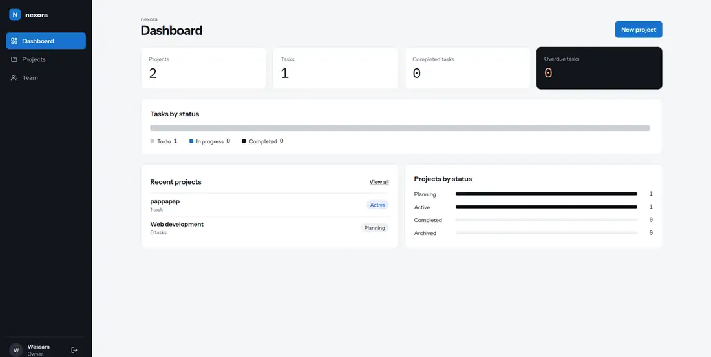
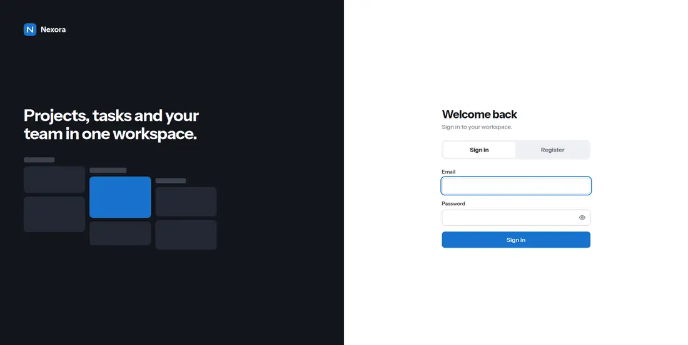
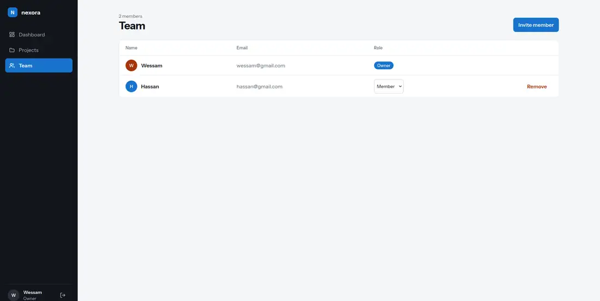

# Nexora

**A multi-tenant project management platform for teams** — companies get their own isolated workspace with projects, task boards, comments, role-based access and email-style invitations.

🔗 **Live demo:** [nexora-kappa-five-53.vercel.app](https://nexora-kappa-five-53.vercel.app)
&nbsp;·&nbsp; Register a new company to try it.


---

## 📸 Screenshots



| Sign in / Register | Team management |
|---|---|
|  |  |

---

## ✨ Features

**Workspaces & team**
- Each company is an isolated tenant — every query is scoped to the user's company
- Company roles: **Owner**, **Admin**, **Member**
- Invite teammates with secure, expiring invitation links (tokens are stored hashed)
- Change member roles or remove members from the team

**Projects & tasks**
- Create, edit and delete projects with a status
- Per-project membership with **Manager** / **Member** roles
- Task board with status (To do · In progress · Completed), priority, assignee and due date
- Task details drawer with comments (create, edit, delete)
- Dashboard with an overview of projects and tasks
- Paginated lists across the app

**Security**
- Session-based auth with HTTP-only cookies and 7-day sessions
- Passwords hashed with **Argon2**
- Database-backed **rate limiting** on login, register and invitation acceptance (per IP and per email)
- Every request body validated with **Zod**
- Consistent API error format with typed error codes

**UI**
- Fully responsive: mobile, tablet and wide-screen layouts

---

## 🛠️ Tech Stack

| Layer | Tech |
|-------|------|
| Framework | Next.js 16 (App Router), React 19 |
| Language | TypeScript |
| Database | PostgreSQL + Prisma 7 (migrations) |
| Validation | Zod |
| Auth | Custom sessions, Argon2 |
| Styling | Tailwind CSS 4 |
| Testing | Vitest |
| Deployment | Vercel |

---

## 🏗️ Architecture

The backend is split into clear layers so route handlers stay thin:

```
Route handler (src/app/api)
   └─▶ Validator (Zod)        – validates and parses input
        └─▶ Service            – business rules & permissions
             └─▶ Repository    – all Prisma / database access
```

```
src/
├── app/
│   ├── (auth)/          # login, register, accept invite
│   ├── (app)/           # dashboard, projects, team
│   └── api/             # REST API route handlers
├── backend/
│   ├── auth/            # sessions, cookies, requireAuth / requireRole
│   ├── services/        # business logic per feature
│   ├── repositories/    # database access
│   ├── validators/      # Zod schemas
│   ├── errors/          # AppError + central error handler
│   ├── lib/             # prisma client, rate limiter, pagination, responses
│   └── tests/           # Vitest unit tests
└── frontend/
    ├── components/      # feature components + reusable UI kit
    ├── services/        # typed API calls
    ├── lib/             # api client, data-fetching hooks
    └── context/         # current user context
```

### Data model

- `Company` → has many `User`, `Project`, `Invitation`
- `Project` → has many `ProjectMember`, `Task`
- `Task` → has many `Comment`
- `Session` and `RateLimit` tables for auth and throttling

---

## 🚀 Getting Started

**Requirements:** Node.js 20+ and a PostgreSQL database.

```bash
git clone https://github.com/mahmoud-ebrahim18725/nexora.git
cd nexora
npm install

cp .env.example .env        # then set DATABASE_URL

npx prisma migrate dev --config prisma7.config.ts
npm run dev
```

Open [http://localhost:3000](http://localhost:3000).

| Script | Description |
|--------|-------------|
| `npm run dev` | Start the dev server |
| `npm run build` | Generate Prisma client and build for production |
| `npm test` | Run the test suite |
| `npm run lint` | Run ESLint |

---

## 🗺️ Roadmap

- [ ] More unit and integration tests
- [ ] CI with GitHub Actions
- [ ] Email delivery for invitations
- [ ] Activity log per project

---

## 👤 Author

Built by **Mahmoud Ebrahim** — [GitHub](https://github.com/mahmoud-ebrahim18725) · [LinkedIn](https://www.linkedin.com/in/mahmoud-ebrahim18725)
